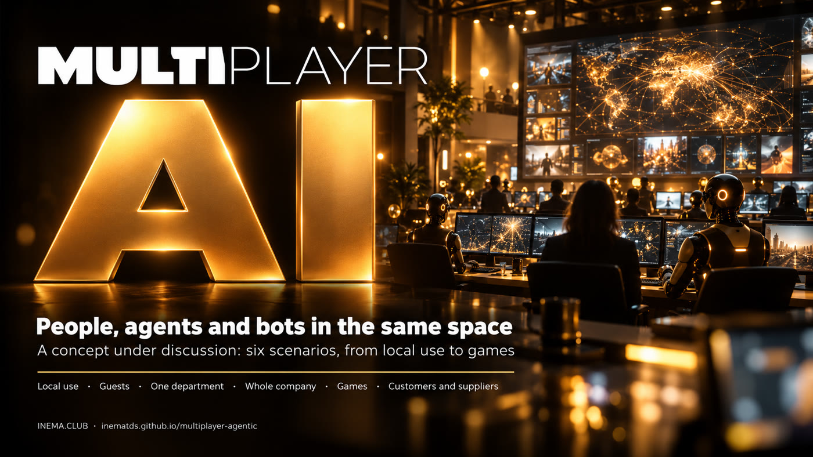

# Multiplayer Agentic

**🇧🇷 [Português](README.md) · 🇺🇸 [English](README.en.md) · 🇪🇸 [Español](README.es.md)**

## What it is

This is a concept document, not a finished program. It discusses what a system would look like where people, AI agents (such as Claude Code and Codex) and Telegram bots share the same channels, like a team chat. Today each person uses AI alone; the idea is for the whole team, humans and agents, to work together and see everything that is happening. It is for anyone who wants to think through this model for personal use, for companies or for games. Just read it: each page brings possibilities, risks and the sources consulted.

## 📖 Read the concept

Full page (landing + document): **https://inematds.github.io/multiplayer-agentic/guia/en/**

- The idea, system shapes, technical base and open questions
- Limits and security · Personalities and profiles
- Six scenarios: local use, with guests, one department, whole company, games, customers and suppliers
- Companies, games, the INEMA case and 17 numbered sources

## Structure

| Path | What it is |
|---|---|
| `CONCEITO.md` | The whole document in one file (in Portuguese) |
| `conteudo/pt/` | Page sources (Markdown + landing). `en/` and `es/` are the translations |
| `tools/build.py` | Builds `guia/` from `conteudo/` (`python3 tools/build.py`) |
| `guia/` | The site published on GitHub Pages |

---

[INEMA.CLUB](https://inema.club)
