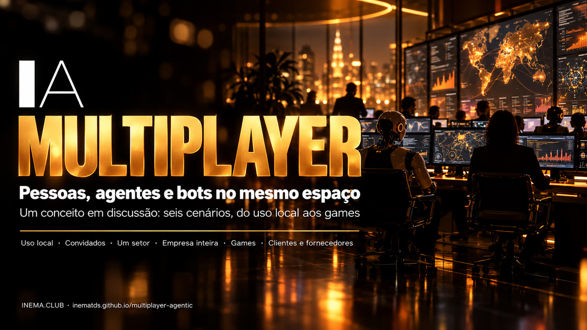

# Multiplayer Agentic

**🇧🇷 [Português](README.md) · 🇺🇸 [English](README.en.md) · 🇪🇸 [Español](README.es.md)**

## O que é

Este é um documento de conceito, não um programa pronto. Ele discute como seria um sistema em que pessoas, agentes de IA (como Claude Code e Codex) e bots do Telegram dividem os mesmos canais, como num chat de equipe. Hoje cada um usa a IA sozinho; a ideia é que o time inteiro, humanos e agentes, trabalhe junto e veja tudo o que está acontecendo. Serve para quem quer pensar esse modelo para uso próprio, para empresas ou para jogos. É só ler: cada página traz possibilidades, riscos e as fontes consultadas.

## 📖 Ler o conceito

Página completa (landing + documento): **https://inematds.github.io/multiplayer-agentic/guia/**

- A ideia, formas do sistema, base técnica e questões em aberto
- Limites e segurança · Personalidades e perfis
- Seis cenários: uso local, com convidados, um setor, empresa inteira, games, clientes e fornecedores
- Empresas, jogos, caso INEMA e 17 fontes numeradas

## Estrutura

| Caminho | O que é |
|---|---|
| `CONCEITO.md` | O documento inteiro num arquivo só |
| `conteudo/pt/` | Fonte das páginas (Markdown + landing). `en/` e `es/` são as traduções |
| `tools/build.py` | Gera `guia/` a partir de `conteudo/` (`python3 tools/build.py`) |
| `guia/` | O site publicado no GitHub Pages |

---

[INEMA.CLUB](https://inema.club)
